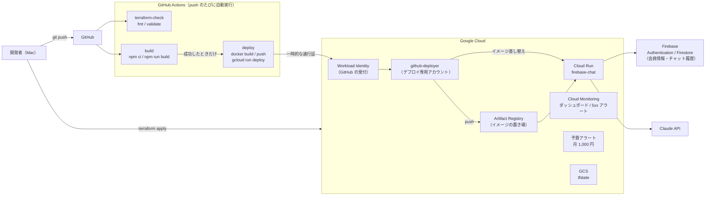

# firebase-chat

Google ログインと会員プランに対応した AI チャットアプリです。
アプリを作って終わりではなく、その上に **インフラのコード管理（Terraform）・監視と予算アラート・CI/CD（鍵を置かない自動デプロイ）** を段階的に積み上げました。

- 本番 URL：https://firebase-chat-648105866948.asia-northeast1.run.app

## 構成図



## アプリの機能

- Google アカウントでログイン（Firebase Authentication）
- 会員プラン（member / premium）によるページの出し分けとアクセス制御
- AI チャット（Claude API）
- チャット履歴の保存（プレミアム会員のみ。Firestore）

## インフラ（Terraform で管理）

| 対象 | 内容 |
|---|---|
| Cloud Run | アプリの実行環境。コンテナイメージの差し替えは CI/CD が担当（`ignore_changes`） |
| サービスアカウント・権限 | 役割ごとにアカウントを分け、必要な権限だけを対象リソースに限定して付与 |
| Workload Identity | GitHub Actions から鍵なしで GCP に入るための受付。このリポジトリからだけ許可 |
| 監視 | Cloud Monitoring のダッシュボード、5xx エラーのアラート、メール通知 |
| 予算 | 月 1,000 円の予算に対して 50% / 90% / 100% でメール通知 |
| tfstate | GCS に保存（バージョニング有効）。ローカルの PC に依存しない |

## CI/CD

`main` に push すると、2 つのワークフローが自動で動きます。

| ワークフロー | ジョブ | やること |
|---|---|---|
| terraform-check | check | Terraform コードの書式（`fmt -check`）と文法（`validate`）を確認 |
| app-build | build | `npm ci` → `npm run build` でアプリがビルドできるか確認 |
| app-build | deploy | build が成功したときだけ実行。Docker イメージを作って Artifact Registry に push し、Cloud Run に反映 |

イメージにはコミット番号のタグを付けているので、本番で動いているのがどのコミットか一目で分かります。

## セキュリティ

- **GitHub に GCP の鍵を置かない**：Workload Identity で、push のたびに数分だけ有効な通行証を発行
- **最小権限**：デプロイ用アカウントができるのは、イメージの push と Cloud Run の更新だけ
- **秘密の値をコードに入れない**：ビルドに必要な設定値は GitHub Secrets に暗号化して保存。`.env.local` は Git にも Docker イメージにも入れない（`.gitignore` / `.dockerignore`）
- **本番コンテナは root 以外のユーザーで実行**（マルチステージビルドで、実行に必要なファイルだけを入れている）

## 使用技術

- アプリ：Next.js / TypeScript / Tailwind CSS / Firebase（Authentication・Firestore）/ Claude API
- インフラ：Google Cloud（Cloud Run・Artifact Registry・Cloud Monitoring・Cloud Billing・GCS）/ Terraform
- CI/CD：GitHub Actions / Docker / Workload Identity 連携

## 今後の改善

- API キーを Secret Manager で管理する（現在は Cloud Run の環境変数）
- 予算管理用アカウントの権限をさらに小さくする
- Terraform の実行も CI から行う（プルリクエストで plan を確認してから apply）
- Kubernetes（GKE）への移行

## ローカルでの起動

```bash
npm ci
npm run dev
```

`.env.local` に次の値を設定してください（値は Git に入れないこと）。

- `NEXT_PUBLIC_FIREBASE_API_KEY` ほか `NEXT_PUBLIC_FIREBASE_` で始まる 6 つ
- `ANTHROPIC_API_KEY`
